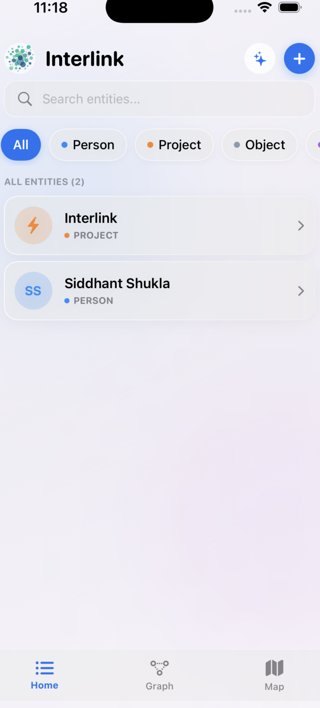
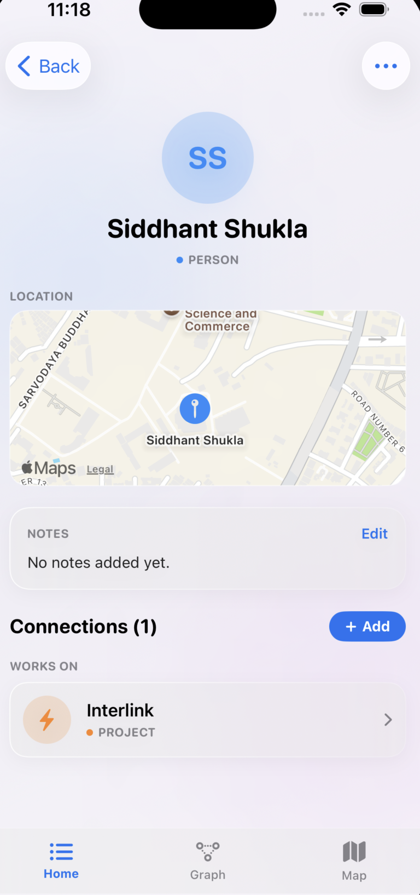
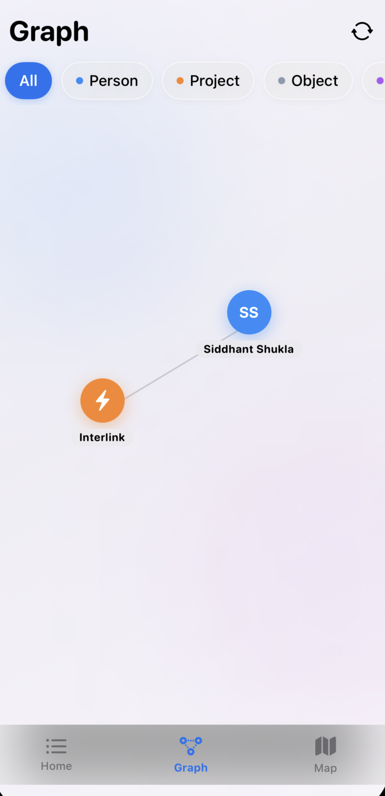
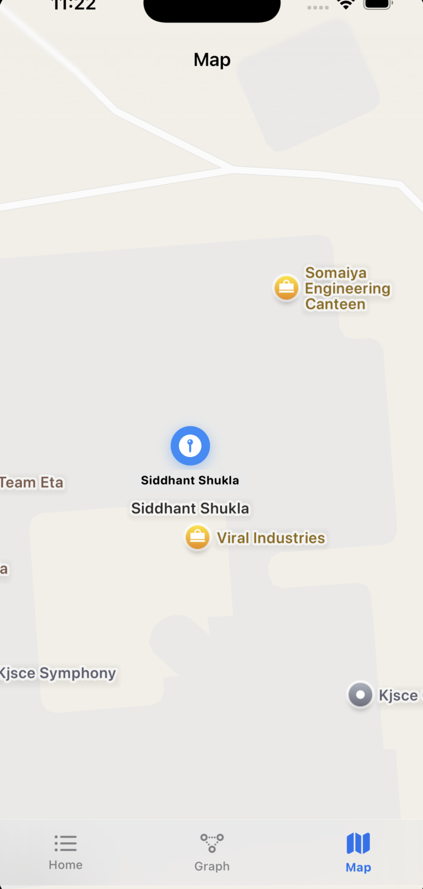
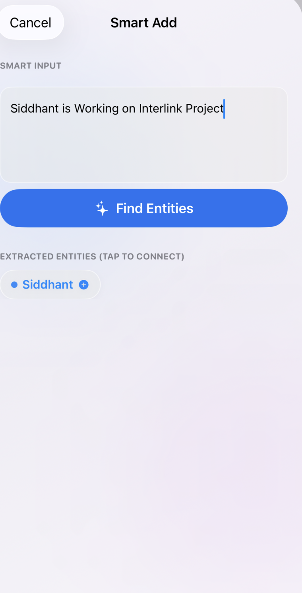

<p align="center">
  
</p>

<h1 align="center">Interlink</h1>
<p align="center"><b>A personal knowledge graph for iOS — capture people, projects, objects, concepts, and places as a connected, explorable network.</b></p>

<p align="center">
  
  
  
  
</p>

---

## What is Interlink?

Most people juggling concurrent projects, collaborators, and ideas have no single place that captures **how things relate to each other**. Notes apps store entities as isolated pages; contacts apps store people without project context. The connections — who worked on what, which project inspired which idea, which concept belongs to which context — live only in memory and get lost.

Interlink is a fully local iOS app that lets you:

- Capture entities as **typed nodes** (Person, Project, Object, Concept, Place)
- Connect them with **bidirectional typed relationships** that read correctly from both sides
- Explore the resulting network as an **interactive visual graph** you can pan, zoom, and rearrange
- Add entities from **natural-language sentences** using on-device NLP
- Attach **real-world addresses** to Place and Person entities and view them on a native map

Everything lives on-device. No account required. No backend.

---

## Screenshots

### Home
Searchable, filterable entity list with type badges and connection counts.
<p align="center"></p>

### Profile
Entity detail view with notes, embedded map for location-linked entities, and grouped connections.
<p align="center"></p>

### Graph
Interactive visual graph — drag nodes to rearrange, pinch to zoom, tap to inspect.
<p align="center"></p>

### Map
Full-screen native map with pins for all Place and Person entities that have coordinates.
<p align="center"></p>

### Smart Add
Type a natural sentence and extract entity names as interactive chips using on-device NLP.
<p align="center"></p>

---

## Features

### Entity Management

Create and manage five distinct entity types, each with a distinct color and icon throughout the app:

| Type | Color | Use case |
|---|---|---|
| Person | Blue | Colleagues, collaborators, contacts |
| Project | Orange | Active or past projects, initiatives |
| Object | Grey | Tools, hardware, documents, artifacts |
| Concept | Purple | Ideas, frameworks, research topics |
| Place | Green | Offices, venues, cities, remote hubs |

Each entity stores a **name**, **type**, optional **notes**, optional **profile photo**, and for Place and Person entities, real-world **coordinates**.

### Deduplication Search

Every name field in the app runs the same normalized dedup search — lowercased, trimmed, matched against existing entity names — debounced as you type. Before a new entity is created, the app surfaces any existing match so you can navigate to it instead. This keeps the graph clean over time and prevents the same real-world entity from fragmenting into multiple nodes.

### Bidirectional Typed Connections

Connect any two entities with a typed relationship. Built-in presets include:

| Forward phrase | Reverse phrase |
|---|---|
| WORKS ON | WORKED ON BY |
| KNOWS | KNOWN BY |
| MANAGES | MANAGED BY |
| OWNS | OWNED BY |
| INSPIRED BY | INSPIRED |
| LOCATED IN | HOSTS |
| MEMBER OF | HAS MEMBER |
| PART OF | PART OF |
| REFERENCES | REFERENCED BY |

You can also define a fully **custom relationship** by entering both the forward and reverse phrasing yourself. Both phrases are stored and used in the correct direction on each entity's detail view — the connection always reads naturally from either side.

Validation blocks self-connections and warns on exact duplicate connections before saving.

### Entity Detail View

Every entity has a dedicated detail view showing:

- Profile avatar (photo thumbnail if set, or type initials/icon)
- Notes (inline editable)
- All **outgoing connections** grouped by forward relationship phrase
- All **incoming connections** grouped by reverse relationship phrase
- An **embedded map** for Place entities that have coordinates
- Edit and delete actions (deletion safely cascade-removes all connected edges)

Tapping any connection row pushes to that connected entity's own detail view — the graph is fully navigable from the list side without ever opening the canvas.

### Interactive Graph Canvas

The Graph tab renders the entire network on a SwiftUI `Canvas` with:

- **Nodes** sized to meet the 44pt minimum tap target, colored and iconed by entity type
- **Edges** as clean lines between connected nodes
- **Tap to inspect** — tap any node to open its detail view
- **Drag to reposition** — drag a node to rearrange the layout; updated coordinates are persisted to SwiftData on gesture release
- **Pinch to zoom / pan** — viewport transform for navigating large graphs
- **Type filter chips** — show or hide node categories to reduce visual density
- **Auto layout engine** — runs off the main thread, computing a radial-by-type layout with a spring-attraction pass for connected nodes
- **Re-layout button** — resets all visible node positions to a freshly computed layout, guarded by a confirmation alert

### Smart Add (On-Device NLP)

Accessible from the sparkles icon on the home screen, Smart Add lets you type a natural sentence — *"Grabbed coffee with Priya and discussed Perkfolio"* — and have candidate entity names automatically extracted as interactive chips, entirely on-device.

- Uses Apple's `NLTagger` with the `.nameType` scheme
- Recognizes `PersonalName`, `PlaceName`, and `OrganizationName` spans
- Each chip shows whether it matches an existing entity or would create a new one
- Tapping a chip opens the Add Connection flow with that entity pre-filled as the target
- The relationship type is always a deliberate user choice — the app extracts names, never infers relationships

### Location & Map

For Place and Person-type entities:

- **Three ways to set a location** in Entity Creation and Edit:
  - **Current Location** — uses CoreLocation GPS to grab the device's coordinates
  - **Select on Map** — opens a full-screen map picker that starts at the user's current location, with a center-pinned marker; pan the map and confirm
  - **Manual search** — type an address and pick from `MKLocalSearch` results
- Selecting a location stores `latitude` and `longitude` on the entity
- The entity's detail view renders a small **embedded map** with a pin at the stored coordinates
- The **Map tab** aggregates all Place and Person entities with coordinates onto a full-screen native `Map`, with custom annotation callouts — tapping a pin navigates to that entity's detail view

---

## Architecture

```
SwiftUI Views  ──► View-level logic (search, connection flow)
     │                     │
     │              Layout Engine (off-main-thread Task)
     │                     │
     └──────────► SwiftData Store (local SQLite)
                           │
               Entity / Connection models
```

### Data Model

```
Entity
  ├── id: UUID
  ├── name: String
  ├── normalizedName: String          ← lowercased + trimmed at init
  ├── typeRaw: String                 ← maps to EntityType enum
  ├── notes: String
  ├── imageData: Data?                ← JPEG thumbnail, max 200x200
  ├── positionX / positionY: Double   ← persisted graph canvas coordinates
  ├── latitude / longitude: Double?   ← Place & Person entities
  ├── outgoing: [Connection]          ← deleteRule .cascade
  └── incoming: [Connection]          ← deleteRule .cascade

Connection
  ├── id: UUID
  ├── from: Entity?
  ├── to: Entity?
  ├── relationshipType: String
  ├── reverseRelationshipType: String
  └── createdAt: Date
```

Both relationships on `Entity` use `deleteRule: .cascade` — deleting an entity safely removes every connection referencing it in either direction with no orphaned rows or crashes.

---

## Technology Stack

| Layer | Technology |
|---|---|
| UI | SwiftUI |
| Persistence | SwiftData (local SQLite, no backend) |
| Graph rendering | SwiftUI `Canvas` + manual hit-region logic |
| Layout computation | Custom Swift layout engine, off-main-thread `Task` |
| Image handling | `UIKit` + `CoreGraphics` (resize + JPEG compress) |
| Name extraction | `NaturalLanguage` — `NLTagger`, `.nameType` scheme |
| Location & maps | `MapKit` — `MKLocalSearch` + SwiftUI `Map` |
| Icons | SF Symbols (vector, no emojis) |

---

## Project Structure

```
Interlink/
├── Models/
│   ├── Entity.swift              ← SwiftData model, initials helper
│   ├── Connection.swift          ← SwiftData model with cascade rules
│   ├── EntityType.swift          ← Enum: person/project/object/concept/place + color/icon
│   └── RelationshipPresets.swift ← Built-in forward/reverse phrasing pairs
│
├── Services/
│   ├── DedupSearchService.swift        ← Normalized entity name matching
│   ├── GraphLayoutEngine.swift         ← Off-main-thread radial + spring layout
│   ├── ImageProcessingService.swift    ← 200x200 JPEG thumbnail compression
│   ├── LocationManager.swift           ← CoreLocation GPS coordinates + reverse geocode
│   ├── LocationSearchService.swift     ← MKLocalSearch address search + coordinates
│   ├── NameExtractionService.swift     ← NLTagger on-device name extraction
│   └── SampleData.swift               ← (disabled by default, no seeding on launch)
│
├── Components/
│   ├── CustomTabBar.swift         ← Glassmorphic bottom tab bar (Home, Graph, Map)
│   ├── EmptyStateView.swift       ← Reusable empty state with optional action button
│   ├── EntityRowView.swift        ← List row: avatar, name, type badge, chevron
│   ├── FilterChipRow.swift        ← Horizontal type-filter chip strip
│   ├── GlassmorphicStyles.swift   ← Shared glass card, pill, and background modifiers
│   ├── NameFieldWithMatches.swift ← Name text field with live dedup match list
│   └── TypeChipPicker.swift       ← Single-select type picker chips
│
├── Views/
│   ├── Home/
│   │   └── EntityListView.swift        ← Searchable, filterable entity list
│   ├── EntityCreation/
│   │   └── EntityCreationView.swift    ← New entity sheet: photo, dedup, type, address
│   ├── Detail/
│   │   └── EntityDetailView.swift      ← Full entity profile + dynamic connections
│   ├── Edit/
│   │   └── EditEntityView.swift        ← Edit entity form (name, type, photo, address)
│   ├── Connection/
│   │   └── AddConnectionView.swift     ← Structured connection flow with presets
│   ├── Graph/
│   │   └── GraphExplorationView.swift  ← Interactive SwiftUI Canvas graph
│   ├── SmartAdd/
│   │   └── SmartAddView.swift          ← NLP sentence input + extracted name chips
│   └── Map/
│       ├── PlaceMapView.swift          ← Native Map tab with Place & Person entity pins
│       └── MapLocationPickerView.swift ← Full-screen map picker with center-pinned marker
│
├── ContentView.swift    ← Root tab switcher
└── InterlinkApp.swift   ← App entry point + SwiftData model container
```

---

## Getting Started

**Requirements**

- Xcode 15 or later
- iOS 17 SDK
- A physical device or simulator running iOS 17+

**Run**

1. Clone the repository
2. Open `Interlink.xcodeproj` in Xcode
3. Select your target device or simulator
4. Press Run (`Cmd + R`)

No package dependencies. No external SDKs. No API keys. Everything runs off Apple's native frameworks.

---

## Design Principles

**Structure over free text.** Every input that could fragment the graph is guided toward existing options — the dedup search exists specifically to prevent the most common data-quality failure mode.

**The list is the safety net, the graph is the reward.** Every screen reachable from the graph is also reachable from the plain list view. The graph is never the only path to an entity.

**Directional clarity.** A relationship reads correctly from both sides. The reverse phrase is stored explicitly at creation time and always displayed from the correct direction.

**Bounded, not busy.** The graph view favors legibility over density. Type filtering and re-layout exist so the canvas never becomes unreadable as the graph grows.

---

## Non-Goals

- Multi-user or multi-device sync — this is a fully local, single-user app
- Live force-directed physics simulation — layout is computed once per trigger and persisted, not recalculated every frame
- Fuzzy name matching — deduplication uses exact normalized-string matching; near-duplicate detection is a deliberate non-goal for this scope
- Automatic relationship inference — Smart Add extracts name candidates only; the user always picks the relationship type manually
- App Store distribution — this is a personal/development build

---

## License

Personal project. All rights reserved.
