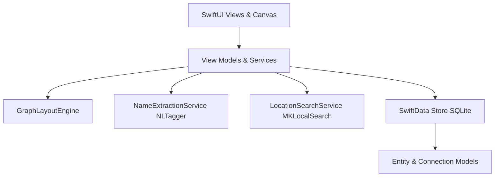

# Interlink — Personal Knowledge Graph

<p align="center">
  <svg width="120" height="120" viewBox="0 0 120 120" fill="none" xmlns="http://www.w3.org/2000/svg">
    <circle cx="60" cy="60" r="56" fill="url(#bg_grad)" stroke="url(#border_grad)" stroke-width="2"/>
    <circle cx="60" cy="32" r="10" fill="#1A73E8"/>
    <circle cx="34" cy="76" r="10" fill="#FB8C00"/>
    <circle cx="86" cy="76" r="10" fill="#AB47BC"/>
    <line x1="60" y1="32" x2="34" y2="76" stroke="#4285F4" stroke-width="3" stroke-dasharray="4 2"/>
    <line x1="60" y1="32" x2="86" y2="76" stroke="#4285F4" stroke-width="3" stroke-dasharray="4 2"/>
    <line x1="34" y1="76" x2="86" y2="76" stroke="#4285F4" stroke-width="3"/>
    <defs>
      <linearGradient id="bg_grad" x1="0" y1="0" x2="120" y2="120" gradientUnits="userSpaceOnUse">
        <stop stop-color="#F8FAFC"/>
        <stop offset="1" stop-color="#EDF2F7"/>
      </linearGradient>
      <linearGradient id="border_grad" x1="0" y1="0" x2="120" y2="120" gradientUnits="userSpaceOnUse">
        <stop stop-color="#0066FF"/>
        <stop offset="1" stop-color="#9933FF"/>
      </linearGradient>
    </defs>
  </svg>
</p>

<p align="center">
  <b>A native iOS app for capturing people, projects, objects, concepts, and places as an interactive, bidirectional graph.</b>
</p>

---

## Architecture Overview



## Key Features

1. **Entity Management & Dedup Search**: Capture entities across 5 typed categories (`Person`, `Project`, `Object`, `Concept`, `Place`) with debounced normalized deduplication search to prevent node fragmentation.
2. **Structured Bidirectional Connections**: Link entities with forward and reverse phrasing pairs (`WORKS ON` ↔ `WORKED ON BY`, `KNOWS` ↔ `KNOWN BY`, `MANAGES` ↔ `MANAGED BY`, etc.).
3. **Interactive Visual Canvas**: Explore your personal network on a vector graph canvas powered by a custom layout engine (`GraphLayoutEngine`). Supports tap-to-inspect, drag-to-reposition with persisted coordinate save, category type filtering, and manual re-layout.
4. **On-Device Natural Language Processing**: Smart Add screen using Apple's `NLTagger` (`.nameType` scheme) to extract entity candidate chips from free-text sentence logs on-device.
5. **Location & Native MapKit**: Address search autocompletion via `MKLocalSearch`, embedded map banners in entity detail views, and a dedicated **Map Tab** plotting all place entities on a native map.

## Technology Stack

- **Framework**: SwiftUI (iOS 17+)
- **Persistence**: SwiftData (Local SQLite)
- **Vector Graphics & Canvas**: SwiftUI `Canvas` & SF Symbols
- **Natural Language Parsing**: `NaturalLanguage` (`NLTagger`)
- **Mapping & Location**: `MapKit` & `CoreLocation`
- **Image Processing**: `UIKit` & `CoreGraphics` (200x200 JPEG thumbnail compression)

---

## Directory Structure

```
Interlink/
├── Components/         # Glassmorphic UI components, tab bar, row items
├── Models/             # SwiftData Entity, Connection, EntityType models
├── Services/           # Dedup search, NLP extraction, MapKit search, Layout engine
├── Views/
│   ├── Connection/     # Structured Add Connection flow
│   ├── Detail/         # Dynamic Entity Detail view & embedded map
│   ├── Edit/           # Edit Entity form
│   ├── EntityCreation/ # Photo picker, address search, entity creation
│   ├── Graph/          # Interactive spatial graph canvas & layout trigger
│   ├── Home/           # Searchable entity list & recency views
│   ├── Map/            # Dedicated Map tab plotting Place entities
│   └── SmartAdd/       # Sentence NLP name extraction screen
└── docs/               # Technical specs, PRDs, architecture, and feature docs
```
