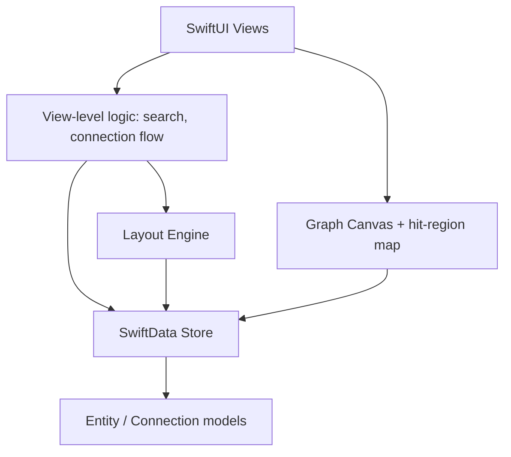
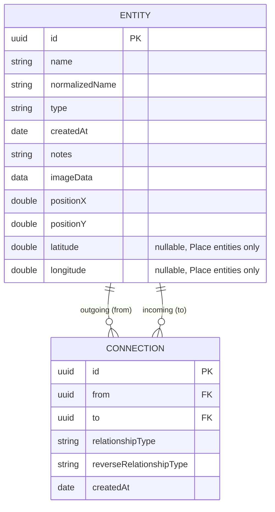

# Interlink — Architecture

> **Status:** Draft | **Last updated:** July 12, 2026

## 1. System Overview
Interlink is a fully local iOS application — there is no backend, no API layer, and no network dependency for core functionality. All data lives in a single on-device SwiftData store. The app is structured as a standard SwiftUI + SwiftData app: SwiftUI views drive user interaction, `@Query`/`@Model` objects handle persistence directly, and a small amount of custom logic (dedup search, graph layout) sits between the two. The most architecturally distinct piece is the graph view, which pairs SwiftUI `Canvas` (drawing) with a manually maintained hit-region map (interaction), since `Canvas` has no built-in hit-testing.

## 2. Architecture Diagram

## 3. Tech Stack
| Layer | Technology | Rationale |
|---|---|---|
| UI | SwiftUI | Native, declarative, matches the target platform and existing plan |
| Persistence | SwiftData | Native Apple ORM over SQLite; avoids hand-rolled Core Data boilerplate |
| Graph rendering | SwiftUI `Canvas` | Immediate-mode drawing suited to a custom node/edge graph; no third-party graph library needed for this scale |
| Layout computation | Custom Swift, off-main-thread `Task` | No external physics/graph-layout library required at personal-graph scale (tens of nodes) |
| Image handling | `UIKit`/`CoreGraphics` resize + JPEG compression | Built-in, no third-party dependency needed |
| Name extraction | NaturalLanguage (`NLTagger`, `.nameType` scheme) | On-device, no training/network call, reliably tags person/place/org name spans in free text |
| Location | MapKit (`MKLocalSearch`, `Map` view) + CoreLocation | Native, free, no third-party maps SDK needed for address search and pin display |
| Infra/Hosting | None (local-only) | No backend required for a single-device personal app |
| Auth | None | Single local user, no accounts |

## 4. Component Breakdown

### 4.1 Entity List / Home View
- **Responsibility:** Display searchable, filterable list of all entities; entry point for creation.
- **Interfaces:** Reads `Entity` via `@Query`; navigates to Entity Detail View and Entity Creation flow.
- **Depends on:** SwiftData store, Dedup Search Service.

### 4.2 Dedup Search Service
- **Responsibility:** Normalize input text and match against existing `Entity.normalizedName`, debounced ~200ms.
- **Interfaces:** Exposed to both Entity Creation and Connection Flow (same search, two call sites).
- **Depends on:** SwiftData store.

### 4.3 Entity Creation Flow
- **Responsibility:** Collect name/type/notes/image, run through Dedup Search Service, create or link to existing `Entity`.
- **Interfaces:** Writes to SwiftData store; invoked from Home View and from Connection Flow (target selection).
- **Depends on:** Dedup Search Service, Image Processing.

### 4.4 Connection Flow
- **Responsibility:** Select source entity, relationship type (preset or custom with reverse phrasing), and target entity (via Entity Creation Flow's search/create).
- **Interfaces:** Writes `Connection` records to SwiftData store.
- **Depends on:** Entity Creation Flow, Relationship Preset Table.

### 4.5 Entity Detail View
- **Responsibility:** Display an entity's profile and all its connections, grouped by type, using correct forward/reverse phrasing.
- **Interfaces:** Reads `Entity.outgoing`/`incoming` via SwiftData relationships; navigates to connected entities.
- **Depends on:** SwiftData store.

### 4.6 Layout Engine
- **Responsibility:** Compute (x, y) positions for all entities (radial-by-type or single spring-relaxation pass), off the main thread, and persist results.
- **Interfaces:** Triggered on entity/connection creation and on manual re-layout; writes `Entity.positionX`/`positionY`.
- **Depends on:** SwiftData store.

### 4.7 Graph Canvas
- **Responsibility:** Render entities/connections from persisted positions; maintain a parallel hit-region map for tap/drag gestures.
- **Interfaces:** Reads positions from SwiftData; writes updated positions on drag end; navigates to Entity Detail View on tap.
- **Depends on:** Layout Engine (initial positions), SwiftData store.

### 4.8 Image Processing
- **Responsibility:** Resize captured/picked photos to a fixed thumbnail size and JPEG-compress before storage.
- **Interfaces:** Called from Entity Creation Flow before writing `imageData`.
- **Depends on:** None external.

### 4.9 Name Extraction Service
- **Responsibility:** Run `NLTagger` (`.nameType` scheme) over free-text sentence input, return candidate name spans typed as person/place/organization.
- **Interfaces:** Invoked from the Smart Add screen; hands off matched/created entities into the Connection Flow (4.4) via Dedup Search Service (4.2), exactly as a manually-selected target would.
- **Depends on:** Dedup Search Service.

### 4.10 Location Service
- **Responsibility:** Run `MKLocalSearch` address queries for Place-type entities and write resulting coordinates to `Entity.latitude`/`longitude`.
- **Interfaces:** Called from Entity Creation/Edit Flow when type is Place; coordinates read by Entity Detail View (embedded map) and the Map Tab.
- **Depends on:** None external beyond MapKit itself.

## 5. Data Model

`Entity.outgoing` is the inverse of `Connection.from`; `Entity.incoming` is the inverse of `Connection.to`. Both relationships use `deleteRule: .cascade` on the `Entity` side so deleting an entity removes every `Connection` referencing it in either direction.

## 6. API Design
Not applicable — Interlink has no network API. All data access goes through SwiftData's local query/save interface directly from view-layer code and the small set of services described above (Dedup Search Service, Layout Engine, Image Processing).

## 7. Infrastructure & Deployment
- No hosting or CI/CD required for the current scope — this is a locally-run/side-loaded personal iOS build.
- Single environment: on-device, debug/dev build via Xcode. No staging/prod split needed until App Store distribution is considered, which is out of current scope.
- If distribution is pursued later, standard TestFlight → App Store pipeline would apply, but this is not part of the current roadmap.

## 8. Security Considerations
- All data is local to the device; no transmission of personal data occurs.
- No authentication needed at this scope (single local user, no accounts).
- If iCloud/CloudKit sync is added later (currently deferred), it would need SwiftData's CloudKit integration and Apple ID-based access control — out of scope for now.

## 9. Scalability & Performance
- Expected load: tens to low hundreds of entities/connections for a single personal user — not a scale problem for SwiftData or in-memory filtering.
- Bottleneck to watch: graph layout computation and Canvas rendering degrade first as node count grows. Layout runs off the main thread and only recomputes on explicit triggers (new entity/connection, manual re-layout) to keep this bounded.
- No caching layer needed at this scale; SwiftData's local queries are fast enough for direct use.
- If usage ever grows well past a few hundred entities, the Phase 3 in-memory type-filtering approach (flagged as an open question in prd.md) would need revisiting in favor of query-level filtering.

## 10. Key Technical Decisions & Tradeoffs
| Decision | Alternatives considered | Why this choice |
|---|---|---|
| Persisted static graph layout, recomputed on trigger | Live force-directed physics every frame | Physics-on-every-frame was identified as the highest-risk, least-demonstrable part of the original concept; persisted layout is bounded and testable |
| Structured connection flow (preset + custom relationship types) | Free-text NLP parsing of sentences like "with Person B" | NLP entity extraction/disambiguation is a real research problem, not a one-line feature, and was undemonstrable within the project's timeline |
| Exact normalized-string dedup | Fuzzy/similarity-based dedup (Levenshtein etc.) | Exact normalization catches the common case (casing/whitespace) with minimal complexity; fuzzy matching deferred as a future enhancement |
| SwiftUI `Canvas` + manual hit-region map | Third-party graph visualization library | Avoids an external dependency for a use case (tens of nodes) that doesn't need a heavyweight graph library |
| Cascade delete on `Entity` relationships | Manual cleanup logic on delete | Letting SwiftData handle cascading is simpler and less error-prone than hand-written cleanup code, once configured correctly |
| `NLTagger` for name extraction only, no relationship inference | Full sentence-understanding pipeline (custom or third-party NLP) | `NLTagger` is on-device, free, and reliable for the narrow name-tagging task; inferring relationship semantics from arbitrary sentences is a much harder, unreliable problem that's better left to explicit user confirmation |
| MapKit/`MKLocalSearch` for Place entities | Third-party maps SDK, or manual lat/long entry | Native, free, no extra dependency; address search is a better UX than asking users to type coordinates by hand |

## 11. Open Technical Questions
- [ ] Should the spring-relaxation layout pass (if used over simple radial placement) run as a fixed number of iterations, or until a convergence threshold — worth prototyping both before committing.
- [ ] At what entity count does in-memory type filtering in the graph view start to show latency, and is that count realistic for actual usage?
- [ ] Should `Connection` enforce uniqueness on (from, to, relationshipType) at the schema level, or is an app-level warning (as specified in feature.md) sufficient?
