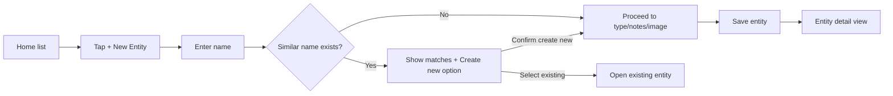
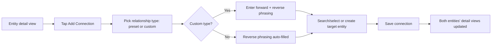
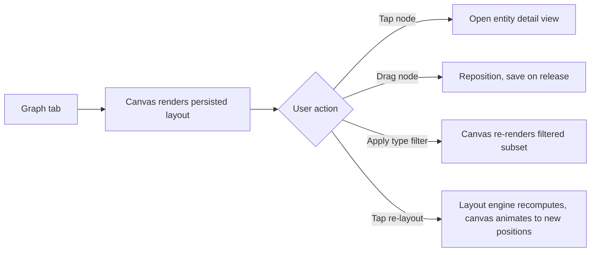
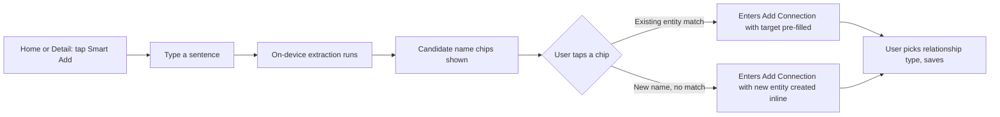

# Interlink — Design Document

> **Status:** Draft | **Last updated:** July 12, 2026

## 1. Design Principles
- **Structure over free text.** Every input that could fragment the graph (entity names, relationship types) is guided toward existing options rather than left as open text.
- **The list is the safety net, the graph is the reward.** Every screen reachable from the graph must also be reachable from a plain list — the graph should never be the only way to find something.
- **Directional clarity.** A relationship must read correctly from both ends; the design should never force the user to mentally reverse a sentence.
- **Bounded, not busy.** The graph view favors legibility over density — filtering and re-layout exist specifically so the canvas never becomes a hairball the user has to squint at.

## 2. User Flows

### 2.1 Create an entity

Narrative: the user taps to create a new entity, types a name, and the app checks it against existing entities in real time. If a close match exists, the user is shown it before being allowed to proceed — this is the point where duplicate fragmentation is prevented. Once through, the user fills in type, optional notes, and optional photo, and lands on the new entity's detail view.

### 2.2 Connect two entities

Narrative: from any entity's detail view, the user starts a connection, picks a relationship type (most of the time a preset with the reverse phrasing already handled), and searches for or creates the target entity using the same dedup flow as entity creation. Saving immediately reflects on both entities.

### 2.3 Explore the graph

Narrative: opening the graph tab shows the network as it was last laid out. The user can tap any node to jump into its detail view, drag nodes to tidy up a local area, filter down to one or more entity types to reduce clutter, or trigger a full re-layout if the graph has become messy from manual dragging.

### 2.4 Smart Add (sentence-assisted connection)

Narrative: the user types a loose sentence describing what happened. The app runs on-device name extraction and shows candidates as chips rather than acting on them automatically. Tapping a chip drops the user straight into the existing Add Connection flow with the target already filled in — the relationship type is still a deliberate choice the user makes, never inferred from the sentence.

### 2.5 Add a Place with location
Narrative (no diagram needed — this is a small addition to the existing Entity Creation flow from 2.1): when the selected entity type is Place, the notes field is joined by an address search field. Selecting a search result fills in coordinates behind the scenes; the rest of the creation flow is unchanged. The entity's detail view will subsequently show an embedded map, and the entity becomes visible on the Map tab.

## 3. Key Screens / Views

### 3.1 Home / Entity List
- **Purpose:** Primary navigation entry point; always-works fallback to the graph view.
- **Key elements:** Search bar, type filter chips, entity rows (name, type icon/thumbnail), floating "+ New Entity" action.
- **States:** empty state — friendly prompt to create the first entity; loading — brief skeleton rows while the initial fetch resolves; error — not expected for a local store, but a generic retry message if a fetch fails; populated — scrollable list, live-filtered as the user types.

### 3.2 Entity Creation
- **Purpose:** Capture a new entity while actively preventing duplicate creation.
- **Key elements:** Name field (with live dedup match list), type picker, notes field, optional photo picker.
- **States:** empty — blank form; typing — match list appears/disappears live below the name field; error — inline validation if name is blank on submit; populated — form fully filled, ready to save.

### 3.3 Entity Detail
- **Purpose:** Single source of truth for one entity's identity and all its relationships.
- **Key elements:** Name, type badge, photo (or placeholder icon), notes, connections grouped by relationship type (correctly worded per direction), "Add Connection" action, edit/delete actions.
- **States:** empty state — "no connections yet" prompt under the connections section; loading — brief skeleton on navigation; error — not expected locally; populated — full profile with grouped connection lists.

### 3.4 Add Connection
- **Purpose:** Structured creation of a typed, bidirectional link between two entities.
- **Key elements:** Source entity (pre-filled, read-only), relationship type picker (presets + custom option), reverse-phrasing field (auto-filled or manually entered for custom types), target entity search field (dedup search reused from entity creation).
- **States:** empty — relationship type unselected, target unselected; error — inline warning if source and target are the same entity, or if an identical connection already exists; populated — ready to save.

### 3.5 Graph View
- **Purpose:** Visual, spatial exploration of the whole network.
- **Key elements:** `Canvas`-rendered nodes (colored/shaped by entity type) and edges, type filter control, "re-layout" button, tap/drag interaction.
- **States:** empty — prompt to add entities/connections if the graph is empty; loading — brief indicator while initial layout computes for a new/large graph; error — not expected locally; populated — full interactive canvas.

## 4. Component Library / Style Guide
| Token | Value | Usage |
|---|---|---|
| Primary color | System accent (iOS default blue, or a single chosen accent) | Primary actions (Save, Add Connection, +) |
| Entity type color coding | Distinct color per `EntityType` (Person, Project, Object, Concept, Place) | Node fills in graph view, type badges in list/detail |
| Font — heading | SF Pro, semibold, 20-22pt | Screen titles, entity names |
| Font — body | SF Pro, regular, 15-17pt | Notes, connection labels, form fields |
| Spacing scale | 8 / 12 / 16 / 24pt | Standard iOS spacing rhythm across all screens |

## 5. Interaction Patterns
- Dedup search results appear inline below the name field with a short fade-in, never as a blocking modal — the user should never feel interrupted while typing.
- Saving a connection gives lightweight haptic + brief confirmation feedback (e.g. a checkmark flash), since there's no navigation away from the detail view that would otherwise confirm the save.
- Dragging a graph node shows a subtle scale-up (~1.05x) while held, returning to normal on release, to make the drag state visually obvious.
- Form validation is inline and immediate (e.g. blank name field), not deferred to a submit-time alert.

## 6. Accessibility
- All interactive elements (list rows, graph nodes, buttons) meet a minimum 44x44pt tap target, including graph nodes — small nodes get an invisible padded hit area larger than their visual size.
- Text contrast targets WCAG AA at minimum across light and dark mode, including text rendered inside colored type-badges and graph nodes.
- VoiceOver: graph nodes expose entity name and type as accessibility labels; dragging is supplemented with an alternative "reposition via detail view" path is not planned — instead, VoiceOver users primarily rely on the list/detail flows, which are fully navigable, with the graph view treated as a supplementary visual mode.
- Dynamic Type is supported on all text-based screens (list, detail, creation, connection flow); the graph view's in-canvas labels have a practical size floor given rendering constraints, called out as a known limitation rather than silently unsupported.

## 7. Responsive / Platform Behavior
- Primary target is iPhone (portrait). iPad support, if pursued later, would benefit from a split view (list + detail side by side) but is not in current scope.
- Graph view canvas sizing adapts to the device's safe area; node density/readability at very small screen sizes may require the type filter more aggressively — this is expected and by design rather than a bug to fix.

## 8. Edge Cases & Error States
- Edge case: user attempts to connect an entity to itself → blocked with inline message at the Add Connection screen.
- Edge case: identical connection (same source, target, relationship type) already exists → warning shown before allowing a duplicate save.
- Edge case: entity has no connections → detail view shows an explicit empty state rather than a blank section.
- Edge case: graph view opened with zero entities → canvas shows an empty-state prompt instead of a blank screen.
- Error state: image picker fails or is cancelled → entity creation proceeds without a photo, no blocking error.

## 9. Open Design Questions
- [ ] Should entity type have a user-visible icon set beyond color coding, for faster visual scanning in both list and graph views?
- [ ] Is a dark-mode-specific palette needed for entity type colors, or does the standard color set translate cleanly?
- [ ] Should the "re-layout" action have an undo, given it overwrites all visible node positions at once?
